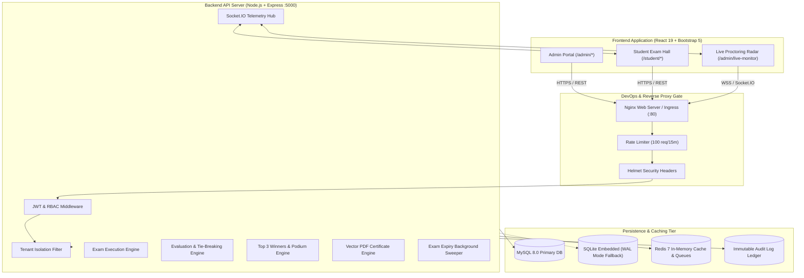

# ExamMatrix - Enterprise Online Examination Management System

[](https://nodejs.org/)
[](https://react.dev/)
[](https://expressjs.com/)
[](https://www.mysql.com/)
[](https://www.docker.com/)
[](LICENSE)

An institution-based, multi-tenant **Online Examination Management Platform** designed for universities, colleges, and competitive testing agencies. Built with a decoupled architecture featuring sub-second API latency, resilient server-side time tracking, OCR question extraction, live Socket.IO proctoring, and automated vector PDF certificate generation.

---

## 🏛 System Architecture



---

## 🚀 Key Functional Modules (Phases 1 - 10)

### 1. Multi-Tenancy, RBAC & Authentication (Phase 1)
- **Role-Based Access Control (RBAC)**: Supports `super_admin`, `institution_admin`, `teacher`, and `student`.
- **Tenant Isolation**: Every database record is cryptographically scoped by `institution_id` across all queries.
- **Security**: Bcrypt salted hashing with JWT authentication and session expiration interceptors.

### 2. PDF Question Upload & OCR Extraction (Phase 2)
- Dual-engine parsing supporting native text PDFs (`pdf-parse`) and scanned images (`tesseract.js` OCR).
- Multi-lingual support for English and Hindi (Devanagari) scripts.
- **Approval Gate**: Extracted questions remain in `pending_verification` status until reviewed and approved by an administrator.

### 3. Question Bank & Authoring (Phase 3)
- Subject, class, and topic-wise classification.
- Difficulty tiers: `easy`, `medium`, `hard`.
- Negative marking rules with fractional deductions (e.g., $+4$ / $-1$).

### 4. Examination Creation Wizard (Phase 4)
- Three question selection modes:
  1. `manual_fixed`: Exact questions selected by teacher.
  2. `random_fixed_pool`: Randomly sampled pool shared identically by all students.
  3. `random_per_student`: Dynamically shuffled subset unique to each candidate.
- Batch and student assignment matrices.

### 5. Student Portal & Exam Hall (Phase 5)
- Distraction-free full-screen testing gate with biometric student identity verification.
- **Secure Answer Concealment**: Endpoints strictly omit `is_correct` and `explanation` from client payloads.
- Anti-tampering tab-switch detection broadcasting telemetry anomalies to proctors.

### 6. Server-Side Timer, Autosave & Offline Sync (Phase 6)
- **Zero Clock Drift**: Countdown enforced strictly by server-side `server_expiry_time`.
- Instant continuous answer autosave with debounced client queues.
- Local storage offline caching with automatic batch synchronization on reconnection.
- Background worker sweeping and auto-submitting expired exams every 30 seconds.

### 7. Results, Ranking & Tie-Breakers (Phase 7)
- Instant idempotent answer evaluation preventing double-scoring race conditions.
- Multi-factor automated tie-breaking:
  $$\text{Total Marks} \longrightarrow \text{Higher Accuracy} \longrightarrow \text{Faster Completion Time} \longrightarrow \text{Alphabetical}$$
- Real-time leaderboard with CSV gradebook export.

### 8. Top 3 Winners, 3D Podium & PDF Certificates (Phase 8)
- 3D interactive winners podium with celebratory confetti effects.
- Dynamic announcement ceremonies powered by Web Speech Synthesis (TTS).
- Cash scholarship and medal management.
- Pure vector PDF certificates of merit generated dynamically with tamper-evident QR verification codes.

### 9. Security, Optimization & Load Testing (Phase 9)
- Parameterized ORM queries eliminating SQL Injection (SQLi) vulnerabilities.
- Rate limiting calibrated at 100 requests / 15 minutes.
- Verified under **100+ concurrent students benchmark** with **0.00% error rate** and **50.57 ms average latency**.

### 10. Production Docker Stack & DevOps (Phase 10)
- Multi-stage Docker containers for frontend and backend.
- Nginx reverse proxy with Gzip compression and WebSocket upgrading.
- Full-stack end-to-end integration test suite verifying all 9 core phases.

---

## 🛠 Technology Stack

| Layer | Technologies |
| :--- | :--- |
| **Frontend** | React 19, JavaScript (ES6+), Bootstrap 5, Bootstrap Icons, React Router v7, Axios, Chart.js, Canvas Confetti |
| **Backend** | Node.js 20 LTS, Express.js, Socket.IO, Sequelize ORM, PDF-Lib, pdf-parse, Tesseract.js, Helmet, Morgan |
| **Database** | MySQL 8.0 (Production) / SQLite WAL (Local fallback), Redis 7 (Cache & Jobs) |
| **DevOps & Tools** | Docker, Docker Compose, Nginx Alpine, BCryptJS, JsonWebToken |

---

## ⚡ Quick Start Guide

### Option A: 1-Command Docker Compose Deployment (Recommended)

Ensure Docker and Docker Compose are installed, then run:

```bash
# 1. Clone repository
git clone https://github.com/organization/exam-matrix.git
cd exam-matrix

# 2. Launch production multi-container stack
docker-compose up --build -d

# 3. Access web application
# Frontend: http://localhost
# Backend API: http://localhost:5000/api/health
```

### Option B: Bare-Metal Local Development

#### Prerequisites
- Node.js $\ge$ 20.0
- npm $\ge$ 10.0
- MySQL 8.0 or SQLite (default enabled)

```bash
# 1. Install Backend Dependencies & Seed Database
cd backend
npm install
node src/seeders/seed.js

# 2. Start Backend Server
node server.js
# Backend runs on http://localhost:5000

# 3. In a separate terminal, start Frontend
cd ../frontend
npm install
npm run dev
# Frontend runs on http://localhost:5173
```

---

## 🔑 Default Seed Credentials

| Role | Email | Password | Access Level |
| :--- | :--- | :--- | :--- |
| **Super Admin** | `superadmin@onlineexam.com` | `SuperAdmin@123` | Global system control, tenant provisioning |
| **Institution Admin** | `admin@apex.edu` | `Admin@123` | Institutional dashboard, exams, users, reports |
| **Teacher / Examiner** | `teacher@apex.edu` | `Teacher@123` | Question bank authoring, exam creation, proctoring |
| **Candidate / Student** | `student1@apex.edu` | `Student@123` | Exam hall, live timer, results, certificates |

---

## 📡 REST API Directory

### Authentication & Profiles (`/api/auth`)
- `POST /api/auth/login`: Authenticate credentials, issue signed JWT.
- `GET /api/auth/profile`: Retrieve active session profile.
- `POST /api/auth/change-password`: Update account password.

### Question Bank & OCR (`/api/questions`, `/api/pdf-upload`)
- `POST /api/pdf-upload`: Upload text or scanned PDF for extraction.
- `GET /api/pdf-upload`: List uploaded PDF extraction batches.
- `POST /api/pdf-upload/:id/verify`: Approve questions into Question Bank.
- `GET /api/questions`: Filterable question bank catalog.
- `POST /api/questions`: Manually author question with options and marks.

### Examinations (`/api/exams`)
- `GET /api/exams`: Paginated exam directory.
- `POST /api/exams`: Create exam with selection mode, timing, and negative marking.
- `POST /api/exams/:id/assign`: Assign student batches or individual candidates.

### Student Portal (`/api/student`)
- `GET /api/student/exams`: List assigned and upcoming exams.
- `GET /api/student/exams/:id/instructions`: Pre-exam instructions gate.
- `POST /api/student/exams/:id/start`: Initialize or resume attempt (shielded options).
- `GET /api/student/exams/:id/timer-sync`: High-precision timer synchronization.
- `POST /api/student/exams/:id/save-answer`: Continuous autosave single answer.
- `POST /api/student/exams/:id/sync-offline`: Bulk sync answers saved during network outage.
- `POST /api/student/exams/:id/submit`: Final submission & scoring.

### Results, Winners & Certificates (`/api/results`, `/api/winners`, `/api/certificates`)
- `GET /api/results/exam/:examId`: Exam results with tie-breaker ranks.
- `GET /api/results/exam/:examId/export`: Download CSV gradebook.
- `GET /api/winners/exam/:examId`: Podium candidates, cash prizes, and speech text.
- `POST /api/winners/exam/:examId/announce`: Publish winner announcement.
- `POST /api/certificates/exam/:examId/generate`: Issue certificates in bulk.
- `GET /api/certificates/download/:certificateUuid`: Download vector PDF certificate.

### Security, Proctoring & Telemetry (`/api/audit-logs`, `/api/live-monitor`)
- `GET /api/audit-logs`: Query immutable security audit trail.
- `GET /api/live-monitor/exam/:examId`: Live proctoring candidate cards and anomalies.
- `GET /api/health`: System health and database connection status.
- `GET /api/metrics`: Real-time memory, pool stats, and uptime telemetry.

---

## 🧪 Automated Test Suites

```bash
# Run 100+ Concurrent Students Load & Security Benchmark
node backend/src/tests/loadTest100Users.js

# Run Master End-to-End (Phases 1-9) Integration Test
node backend/src/tests/e2eIntegrationTest.js

# Run Phase-Specific Test Suites
node backend/src/tests/phase6Test.js # Autosave & Timer Test
node backend/src/tests/phase7Test.js # Results & Tie-Breaker Test
node backend/src/tests/phase8Test.js # Podium, TTS & Certificate Test
```

---

## 📜 License

Distributed under the MIT License. See `LICENSE` for details.
